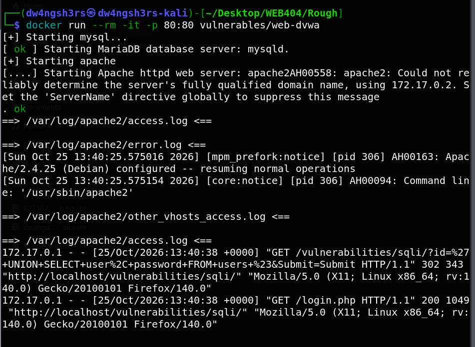
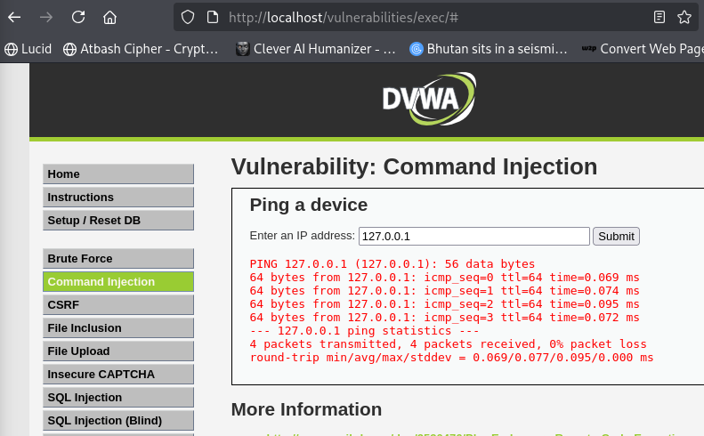
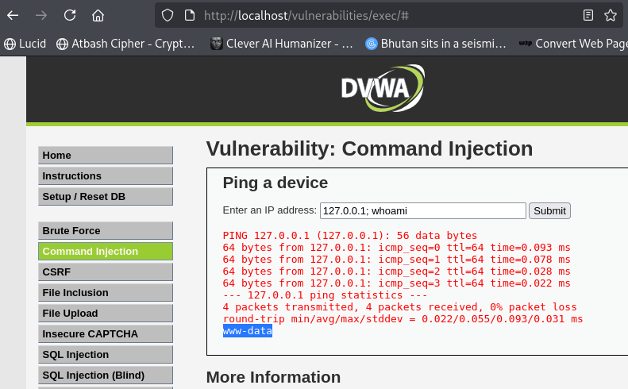
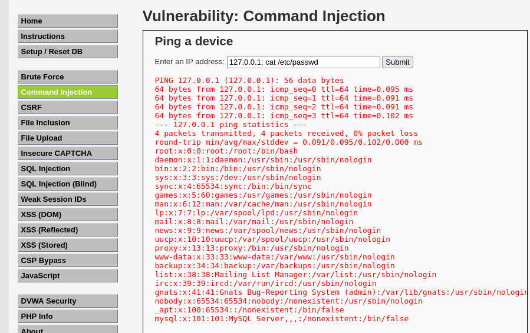
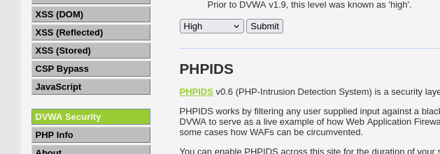
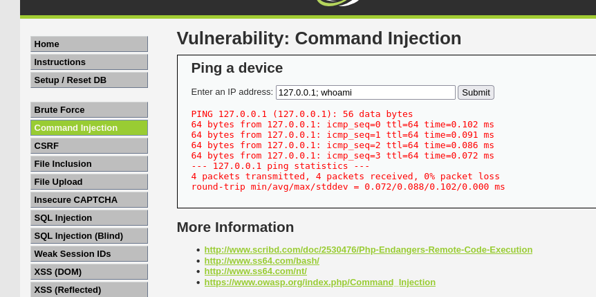
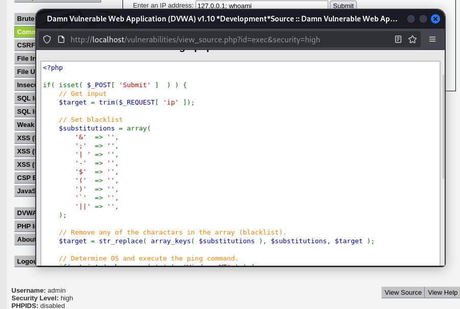

# Assignment 3 — Command Injection and Safeguards

**Name:** Dechen Wangdra Sherpa
**Student No:** 02230281
**Module:** Web Application Security (WEB404)

---

## 1. Aim

To create (use) a command-line interface in a web application and implement safeguards against command injection, by first exploiting the vulnerability and then demonstrating how it is blocked.

## 2. Introduction

Command injection occurs when a web application passes unsanitised user input into a system shell command. Because the input is not separated from the command, an attacker can append their own OS commands and have the server execute them.

This assignment uses **DVWA's Command Injection module**, which takes an IP address and runs the system `ping` command on it. The attack was performed at **Low** security, and the safeguard demonstrated at **High** security, on **Kali Linux** with DVWA running in Docker.

## 3. Setup

DVWA was already deployed in a Docker container (from the previous assignment), serving the application on port 80:

```bash
docker run --rm -it -p 80:80 vulnerables/web-dvwa
```



## 4. Implementation

The target is the **Command Injection** page ("Ping a device"). The vulnerable code builds a shell command roughly like:

```php
ping -c 4 <user input>
```

The user input is concatenated straight into the command with no filtering, so shell metacharacters such as `;` allow extra commands to run.

### 4.1 Baseline — normal use

Entering a valid IP `127.0.0.1` returns the expected ping output — the CLI working as intended.



### 4.2 Attack 1 — Command chaining

The following was entered in the IP field:

```
127.0.0.1; whoami
```

The `;` ends the ping command and starts a second one. The output shows the normal ping **followed by `www-data`** — the account the web server runs as. This confirms an injected command executed on the server.



### 4.3 Attack 2 — Reading a sensitive file

```
127.0.0.1; cat /etc/passwd
```

The ping output is followed by the full contents of `/etc/passwd`, listing every system account (`root`, `daemon`, `www-data`, `mysql`, etc.). This shows an attacker can read arbitrary server files.



## 5. Safeguard — Blocking the Injection

The DVWA security level was changed to **High**, which loads a hardened version of the code.



The same attack `127.0.0.1; whoami` was submitted again. This time only the ping runs — **no `www-data` line appears** — so the injected command was neutralised.



### 5.1 How the safeguard works

The **View Source** of the High-level code shows the defence: a blacklist that strips dangerous shell metacharacters from the input before it reaches the command.



The code removes characters such as `&`, `;`, `|`, `$`, `` ` ``, `(`, `)`, `-`, and `||` using `str_replace`, so a payload like `127.0.0.1; whoami` has its `;` stripped and becomes a harmless string that only pings.

> Note: character blacklisting (as DVWA does here) is a basic safeguard and can sometimes be bypassed. The stronger, recommended approach is **input whitelisting** (only allow a valid IP format) and **avoiding shell execution entirely** by using safe APIs.

## 6. Results

| Step | Input | Outcome |
|------|-------|---------|
| Baseline | `127.0.0.1` | Normal ping output |
| Attack 1 | `127.0.0.1; whoami` | `www-data` returned — command executed |
| Attack 2 | `127.0.0.1; cat /etc/passwd` | System account file dumped |
| Safeguard (High) | `127.0.0.1; whoami` | Blocked — ping only, no extra command |

## 7. Mitigation (Safeguards)

1. **Input whitelisting / validation** — accept only a strict valid IP format and reject everything else. This is the primary fix.
2. **Avoid calling the shell** — use language functions or libraries that perform the task without spawning a shell, so metacharacters have no meaning.
3. **Escape / filter metacharacters** (`;`, `&`, `|`, `` ` ``, `$`, etc.) as a secondary layer, as DVWA's High code does.
4. **Least privilege** — run the web server as a low-privilege account to limit damage if injection succeeds.

## 8. Conclusion

A web-based command-line interface (DVWA's ping tool) was exploited through command injection to run arbitrary commands (`whoami`) and read a protected file (`/etc/passwd`). The safeguard was then demonstrated by switching to High security, where the same attack was blocked by filtering dangerous characters. The assignment showed both the severity of command injection and that validating/whitelisting input — and avoiding shell execution — are the correct defences.
